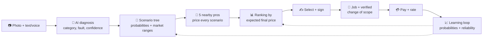

# GetHandyMan

**A "Gett for home repairs": a marketplace for handymen, plumbers, electricians and AC technicians, with an AI and algorithmic mechanism that keeps prices fair.**

Final project, B.Sc. Computer Science, Afeka College of Engineering (2026–2027).

| | |
|---|---|
| **Supervisor** | Dr. Yair Even-Zohar |
| **Team** | Idan Lachovitz · Idan Pekler |
| **Status** | Phase 1: definition, research & analysis |

---

## The idea in one paragraph

A customer photographs a fault and describes it in text or a voice note. Nearby professionals send price quotes, and the customer chooses. The problem we solve is **bait-and-switch**: a deliberately low quote, then a price jump on site. GetHandyMan combines four components: **(1)** an AI that *diagnoses* the fault but never sets the price, **(2)** contingent quotes in which every plausible scenario is priced in advance, **(3)** a documented, AI-verified change-of-scope protocol, and **(4)** ranking by *expected final price* = quote × the professional's Bayesian overrun factor. Together they make a deliberately low quote stop paying off.

## Documents

| # | Document | Status |
|---|----------|--------|
| 1 | [Project Definition](docs/01-project-definition.md) | ✅ Draft v0.1 |
| 2 | [Literature Review](docs/02-literature-review.md) | ✅ Draft v0.1 |
| 3 | [Competitors Review](docs/03-competitors-review.md) | ✅ Draft v0.1 |
| 4 | [Project Analysis](docs/04-project-analysis.md) | ✅ Draft v0.1 |
| — | [Meeting Log](docs/meetings/README.md) | Ongoing |
| — | Business Plan | ⏳ To be uploaded (`docs/business-plan/`) |
| — | Clickable prototype (5 screens) | ⏳ Link to be added |

## How it works



**Core formula:** `Expected final price = Σ p(scenario) · price(scenario) × overrun factor (Empirical Bayes)`. See [Project Analysis §6.4](docs/04-project-analysis.md#64-overrun-factor-and-ranking-empirical-bayes).

## Repository structure

```
GetHandyMan/
├── README.md
└── docs/
    ├── 01-project-definition.md
    ├── 02-literature-review.md
    ├── 03-competitors-review.md
    ├── 04-project-analysis.md
    └── meetings/
        └── README.md
```

Source code (`app/`, `backend/`, `simulator/`) will be added from Phase 3 onward.

## Project management

Tasks are tracked on the repository's GitHub Project board (Iterative Development template), with one iteration per week aligned to supervisor milestones.
