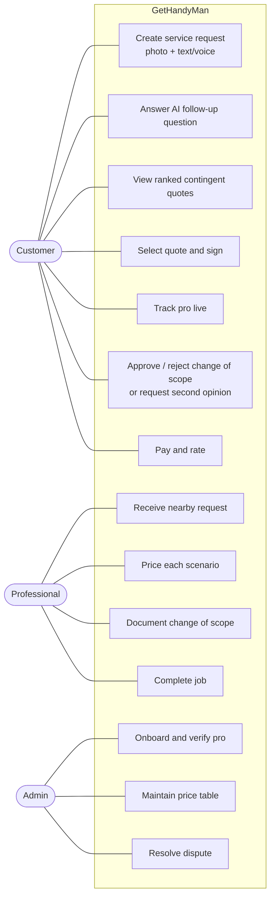
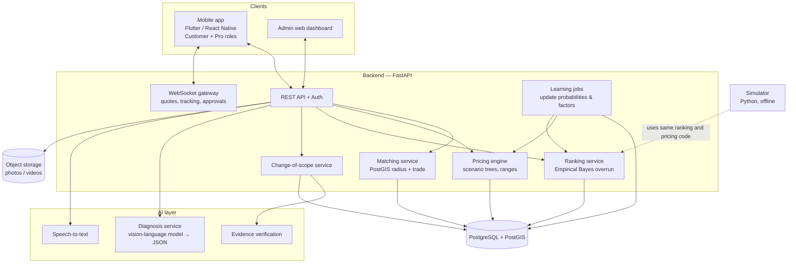
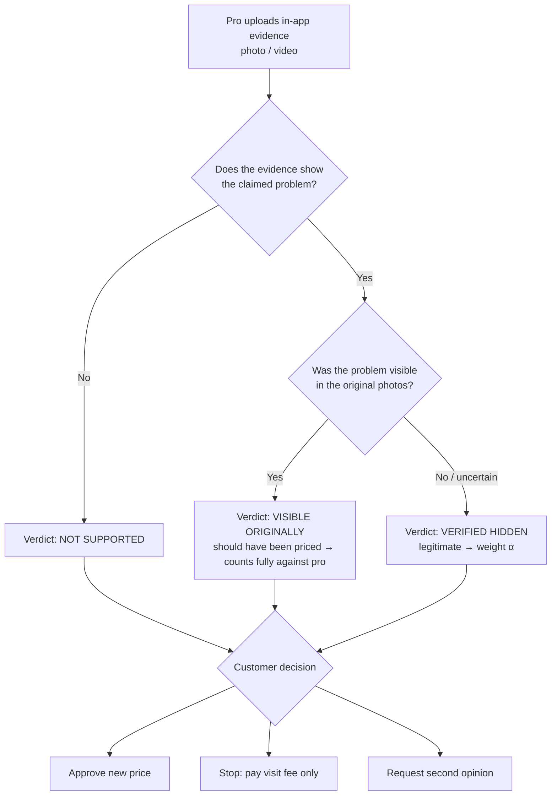
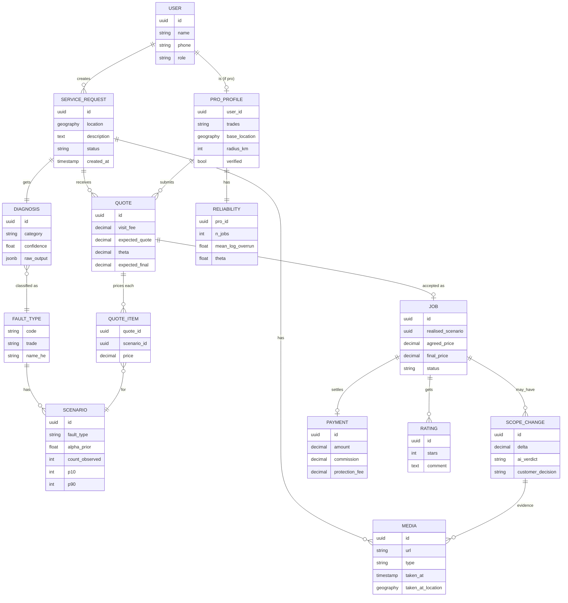
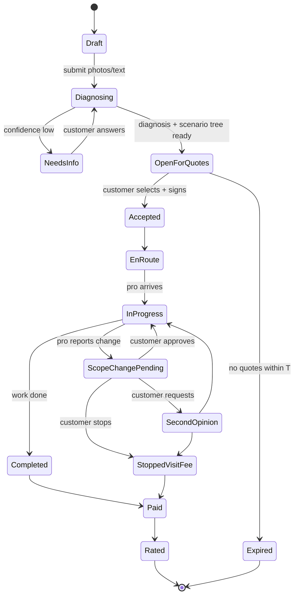
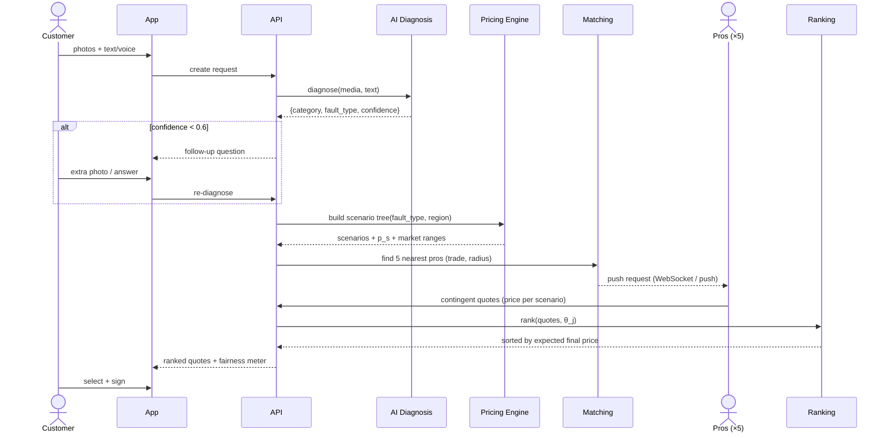
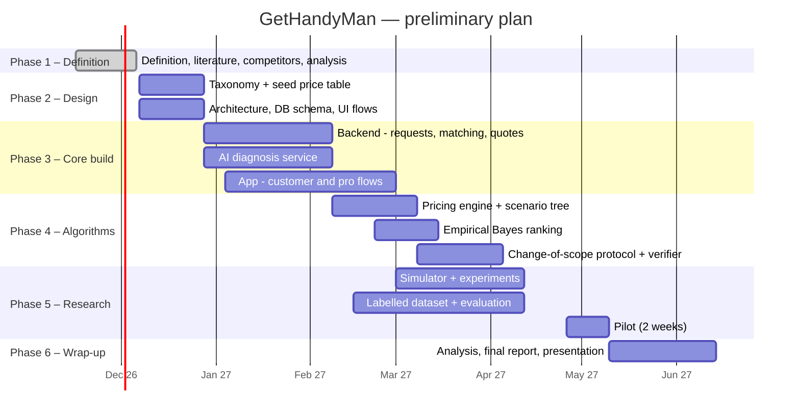

# GetHandyMan — Project Analysis

**Version:** 0.1 (draft) — November 2026
**Team:** Idan Lachovitz, Idan Pekler
**Supervisor:** Dr. Yair Even-Zohar

This document turns the [Project Definition](01-project-definition.md) into an engineering analysis: actors and use cases, requirements, architecture, data model, the core algorithms with their formulas, the evaluation plan, the risks, and the project plan.

---

## 1. Actors

| Actor | Description |
|-------|-------------|
| **Customer** | Opens a service request, chooses a quote, approves or rejects changes of scope, pays and rates |
| **Professional (Pro)** | Receives nearby requests, submits contingent quotes, documents changes of scope, completes jobs |
| **Admin** | Onboards and verifies professionals, maintains the price table, handles disputes and second opinions |
| **AI Diagnosis Service** (system actor) | Converts photo + text/voice into a structured diagnosis and verifies change-of-scope evidence |
| **Pricing Engine** (system actor) | Builds scenario trees and market ranges and computes expected prices and rankings |

## 2. Use Cases



### Main use-case descriptions

**UC1: Create service request**
- *Precondition:* the customer is logged in and location permission is granted.
- *Main flow:* (1) The customer takes 1–5 photos and adds text or a voice note. (2) The system transcribes the voice. (3) The AI returns a structured diagnosis. (4) If confidence is below the threshold, the AI asks one follow-up question (UC2) and re-diagnoses. (5) The pricing engine builds the scenario tree and market ranges. (6) The customer confirms and the request is sent to the 5 nearest suitable professionals.
- *Alternative flow:* no suitable professional within radius R → the radius is widened step by step, or the customer is notified.

**UC9: Price each scenario**
- The professional sees the photos, the diagnosis, and the scenario tree with market ranges, and enters a price for **every** scenario plus a visit fee. The UI shows in real time whether each price is inside, below or above the market range. The quote cannot be submitted with an unpriced scenario.

**UC3: View ranked quotes**
- The quotes are ranked by **expected final price** (§6.4). The customer can toggle between "expected price" and "quoted price", and each quote shows a fairness meter (its position relative to the market range) and the professional's reliability badge.

**UC10 + UC6: Change of scope**
- (1) The professional reports an unplanned finding and attaches a photo or video taken in-app. (2) The AI classifies the evidence (§6.5). (3) The customer sees the evidence, the AI verdict and the proposed new price. (4) The customer chooses: approve / stop and pay the visit fee only / request a second opinion. (5) The outcome is recorded and feeds the overrun model.

## 3. Functional Requirements

Priority uses MoSCoW: **M**ust, **S**hould, **C**ould.

| ID | Requirement | Priority |
|----|-------------|----------|
| **Requests & diagnosis** | | |
| FR-1 | Customer can create a request with 1–5 photos, text and/or a voice note | M |
| FR-2 | Voice notes are transcribed to text (Hebrew) | S |
| FR-3 | The AI returns a structured diagnosis: category, fault type, confidence, visible evidence | M |
| FR-4 | If confidence < threshold, the AI asks one follow-up question before finalising | M |
| **Pricing** | | |
| FR-5 | The pricing engine builds a scenario tree (scenarios + probabilities) per fault type | M |
| FR-6 | Each scenario has a market range (P10–P90) from historical data or the seed price table | M |
| FR-7 | Prices are never generated by the LLM | M |
| **Matching & quotes** | | |
| FR-8 | The request is sent to up to 5 nearby professionals in the matching trade (PostGIS) | M |
| FR-9 | A professional must price every scenario plus a visit fee to submit a quote | M |
| FR-10 | Real-time in-range / out-of-range indicator while pricing | S |
| FR-11 | Quotes are ranked by expected final price = expected quote × overrun factor | M |
| FR-12 | Customer can toggle "expected" vs. "quoted" price and see a fairness meter | S |
| **Job execution** | | |
| FR-13 | Customer selects a quote and both sides digitally sign the scenario agreement | M |
| FR-14 | Live tracking of the professional's location on the way to the job | S |
| FR-15 | Change of scope requires in-app photo/video evidence | M |
| FR-16 | The AI verifies the evidence and checks visibility in the original photos | M |
| FR-17 | Work cannot continue after a change of scope without customer approval | M |
| FR-18 | Customer can request a second opinion | C |
| **Closing & learning** | | |
| FR-19 | Simulated payment and mutual rating | M |
| FR-20 | After each job, scenario probabilities and the pro's overrun factor are updated | M |
| **Admin** | | |
| FR-21 | Admin dashboard: pro onboarding, price table, disputes | S |
| **Research tools** | | |
| FR-22 | Agent-based simulator for comparing ranking mechanisms | M |
| FR-23 | Evaluation scripts for the diagnosis dataset and price-range coverage | M |

## 4. Non-Functional Requirements

| Category | Requirement |
|----------|-------------|
| Performance | AI diagnosis ≤ 15 s; quote ranking ≤ 1 s; real-time events delivered in ≤ 2 s |
| Availability | Demo/pilot level: one cloud instance; 99% during the pilot weeks |
| Security & privacy | JWT auth; role-based access (customer / pro / admin); photos and addresses are visible only to the parties of the job; location is shared only during an active job |
| Auditability | Every quote, signature, change of scope and AI verdict is stored immutably with timestamps, as the basis for disputes |
| Explainability | The customer can always see *why* a quote ranks where it does (quote, overrun factor, number of jobs behind it) |
| Fairness | A pro subscription never affects ranking; new pros are protected by Bayesian shrinkage |
| Localisation | Hebrew UI (RTL) first; English for development and docs |
| Maintainability | Modular services; the AI model, price table and ranking parameters are configurable without code changes |

## 5. System Architecture



**Key design decision:** the simulator imports the **same** ranking and pricing modules as the production backend, so the simulation results are about the real code, not a re-implementation.

## 6. Core Algorithms

### 6.1 AI diagnosis (structured output)

The vision–language model is prompted to return strict JSON, validated against a schema:

```json
{
  "category": "plumbing",
  "fault_type": "sink_leak_under_basin",
  "confidence": 0.72,
  "visible_evidence": ["water drops at trap joint", "corrosion on nut"],
  "follow_up_question": "Please take a close-up photo of the connection under the sink.",
  "safety_flag": false
}
```

- `fault_type` must come from a **closed taxonomy** maintained by us, about 30–50 fault types across the 4 trades.
- If `confidence < 0.6`, the follow-up question is shown and the diagnosis re-runs with the extra photo/answer (once).
- `safety_flag` (e.g. a burning smell or exposed wiring) triggers a safety message and an "urgent" tag.
- The model never outputs prices; the schema has no price field.

### 6.2 Scenario tree and scenario probabilities

Each `fault_type` has a list of scenarios $s_1 \dots s_K$ defined in the price table (e.g. *seal / siphon / pipe in wall*). The probability of each scenario is learned with a **Dirichlet–multinomial** model:

$$
p_s = \frac{\alpha_s + n_s}{\sum_{k} \alpha_k + N}
$$

- $\alpha_s$: prior pseudo-counts from expert knowledge (the initial 60/30/10 table)
- $n_s$: the number of completed jobs of this fault type in which scenario $s$ was the one that actually happened; $N = \sum_k n_k$

As data accumulates, the probabilities move from the expert prior to the observed frequencies.

### 6.3 Market ranges (pricing engine)

For each (scenario, trade, region), the market range is the **P10–P90** interval of final prices of past jobs. While there are fewer than $n_{min}$ (e.g. 20) jobs, the engine falls back to the **seed price table**. This table is compiled by the team from public price lists and interviews with professionals.

### 6.4 Overrun factor and ranking (Empirical Bayes)

**Contingent quote.** Professional $j$ prices every scenario: $q_{j,1}, \dots, q_{j,K}$. The **expected quote** is

$$
E_j = \sum_{s} p_s \, q_{j,s}
$$

**Observed overrun.** For each completed job $i$ of professional $j$, let $Q_{ji}$ be the agreed price of the scenario that actually happened and $F_{ji}$ the final price paid. Changes of scope are weighted by their verification outcome:

$$
F'_{ji} = Q_{ji} + \sum_{c} w_c \, \Delta_c,\qquad
w_c = \begin{cases}
\alpha & \text{verified hidden damage (approved)}\\
1 & \text{visible in original photos, or unverified}
\end{cases}
$$

where $\alpha \in [0,1]$ (e.g. 0.2) is a tunable parameter, so legitimate hidden damage costs an honest professional little. The per-job log-overrun is $y_{ji} = \ln(F'_{ji} / Q_{ji})$.

**Hierarchical model.** Within each trade $c$:

$$
y_{ji} \sim \mathcal{N}(m_j, \sigma^2), \qquad m_j \sim \mathcal{N}(\mu_c, \tau_c^2)
$$

$\mu_c$, $\tau_c^2$ and $\sigma^2$ are estimated from all professionals' data (method of moments). This is the "empirical" in Empirical Bayes.

**Posterior (shrinkage) estimate** for a professional with $n_j$ jobs and mean log-overrun $\bar{y}_j$:

$$
\hat{m}_j = w_j \bar{y}_j + (1 - w_j)\mu_c, \qquad
w_j = \frac{n_j \tau_c^2}{n_j \tau_c^2 + \sigma^2}, \qquad
v_j = \left(\frac{n_j}{\sigma^2} + \frac{1}{\tau_c^2}\right)^{-1}
$$

$$
\theta_j = \exp\!\left(\hat{m}_j + \tfrac{1}{2} v_j\right) \quad \text{(overrun factor)}
$$

**Ranking score.**

$$
\text{ExpectedFinal}_j = E_j \times \theta_j
$$

Quotes are sorted ascending by $\text{ExpectedFinal}_j$. Distance and rating are used only as tie-breakers.

**Worked example.** The parameters are illustrative: $\mu_c = \ln 1.10$, $\tau_c = 0.15$, $\sigma = 0.25$.

| Pro | Expected quote $E_j$ | History | Shrinkage weight $w_j$ | Overrun factor $\theta_j$ | Expected final | Rank |
|-----|---------------------|---------|------------------------|---------------------------|----------------|------|
| Yossi | ₪200 | 20 jobs, avg ×1.05 | 0.88 | 1.06 | **₪211** | 1 |
| New pro, 1 bad job | ₪180 | 1 job at ×2.0 | 0.27 | 1.30 (not 2.0!) | **₪234** | 2 |
| Danny | ₪150 | 20 jobs, avg ×1.8 | 0.88 | 1.70 | **₪255** | 3 |

For comparison, a brand-new pro with **no history** quoting ₪180 gets the prior factor $\theta = 1.11$, an expected final price of ₪200, and would rank first. Danny's low quote no longer wins. A newcomer with one bad job is penalised only mildly, but the penalty grows if the pattern repeats.

### 6.5 Change-of-scope verification



- Evidence must be captured **in-app** (camera only, no gallery upload), with a timestamp and GPS inside the job location, to prevent reused photos.
- The AI verdict is **advisory**; the customer always decides. All verdicts are stored for audit and for evaluating the verifier.

### 6.6 Learning loop

After each closed job:
1. Increment $n_s$ for the realised scenario → update $p_s$ (§6.2).
2. Add the final price to the market-range data (§6.3).
3. Add $y_{ji}$ to the professional's history and update $\theta_j$ (§6.4); re-estimate $\mu_c, \tau_c, \sigma$ nightly.

## 7. Data Model



## 8. Job Lifecycle (State Machine)



## 9. Main Sequence: From Photo to Ranked Quotes



## 10. Simulator Design

**Purpose:** show that lowballing pays under a naive mechanism and stops paying under ours.

| Element | Design |
|---------|--------|
| Map | Tel Aviv area, with requests and pro locations sampled over neighbourhoods |
| Requests | Fault types drawn from the taxonomy; true scenario drawn from $p_s$; true cost from market ranges |
| Honest pros | Quote ≈ true cost × (1 + margin); final ≈ quote (small noise, real hidden damage) |
| Strategic pros | Quote = λ × fair price (λ ∈ [0.6, 0.8]); on site raise to fair price × markup |
| Customer choice | Pick the top-ranked quote (with some noise / distance sensitivity) |
| Mechanisms compared | **M0** lowest quote wins; **M1** sort by star rating; **M2** ours (expected final price) |
| Horizon | e.g. 52 simulated weeks, multiple random seeds |

**Outputs:** market share of strategic vs. honest professionals over time, average customer overpayment (final − fair), honest professionals' income, and the false-penalty rate for honest professionals who encountered real hidden damage. Sensitivity analysis covers $\alpha$, the prior strength $\tau_c$ and the share of strategic professionals. Optional extension: strategic professionals *adapt* their λ over time (best response), to test robustness.

## 11. Evaluation Plan

| What | Data | Metric | Target |
|------|------|--------|--------|
| Diagnosis accuracy | Several hundred labelled faults | Top-1 / top-3 accuracy of fault type; macro-F1 | Set after the baseline run |
| Confidence calibration | Same | Expected Calibration Error (ECE) | Lower than an uncalibrated baseline |
| Price-range coverage | Labelled faults with real final prices + pilot | % of real final prices inside the predicted P10–P90 range | ≈ 85% (pilot) |
| Range usefulness | Same | Mean range width relative to price | As narrow as possible at the target coverage |
| Mechanism effect | Simulator | Strategic pros' market share and customer overpayment, M0 vs. M1 vs. M2 | M2 clearly lower |
| Fairness to honest pros | Simulator | False-penalty rate | Low and stable |
| Change-of-scope verifier | Pilot + staged examples | Precision / recall of "visible originally" verdict | Report with error analysis |
| Real-world pilot | 10–20 pros, 2 weeks | Coverage, # scope changes, customer satisfaction, pro feedback | Descriptive + coverage target |

## 12. Technology Choices

| Need | Choice | Why |
|------|--------|-----|
| One app, two roles | **Flutter** or React Native (to be decided in week 1) | Single codebase for iOS/Android; Hebrew RTL support |
| Backend | **FastAPI (Python)** | Same language as the AI, simulator and statistics code, so ranking modules are shared |
| Database | **PostgreSQL + PostGIS** | Geographic radius queries, transactions, JSONB for AI output |
| Real-time | **WebSockets** | New quotes, live tracking, scope-change approvals |
| AI diagnosis | Hosted **vision–language model** with JSON-schema output | Zero-shot on a closed taxonomy; can be swapped |
| Speech-to-text | Whisper-family model with Hebrew support | Voice descriptions in Hebrew |
| Storage | S3-compatible object storage | Photos and videos |
| Payments | Simulated | Out of scope for a student project |
| Project management | GitHub repo + GitHub Projects (iterations) | Required by the supervisor |

## 13. Risks and Mitigations

| # | Risk | Impact | Mitigation |
|---|------|--------|------------|
| R1 | Not enough real price data for good ranges | High | Seed price table + Dirichlet/shrinkage priors; report coverage honestly |
| R2 | AI misdiagnosis | Medium | Closed taxonomy, confidence threshold + follow-up question, pro can flag a wrong diagnosis |
| R3 | Pros game the system, e.g. reusing photos or refusing to document changes | High | In-app camera only, timestamp + GPS check, undocumented changes count fully against the pro |
| R4 | Too few pros/customers for a meaningful pilot | Medium | Recruit through family and acquaintances early; the simulator carries the main quantitative claim |
| R5 | Hebrew voice/text quality | Low–Medium | Text input always available; Hebrew-tuned speech model |
| R6 | Scope creep (business features) | High | MoSCoW priorities; business features (subscriptions, B2B) only described, not built |
| R7 | Privacy of photos and addresses | Medium | Role-based access, data visible only to job parties, retention policy |
| R8 | Legal questions (consumer protection, liability) | Low (academic) | Out of scope for implementation; noted in the business plan |

## 14. Project Plan (preliminary)



*Dates are placeholders until the department's submission calendar is confirmed.*

## 15. Open Questions for the Supervisor

1. Is the simulator + dataset + small pilot an acceptable evaluation scope, or does the department expect a larger pilot?
2. Should the academic focus lean more toward the **mechanism** (simulation, incentive analysis) or the **AI** (diagnosis and verification accuracy)?
3. Are there constraints on using commercial AI APIs (cost, data privacy) versus open models?
4. How much of the business plan should be part of the final report?
